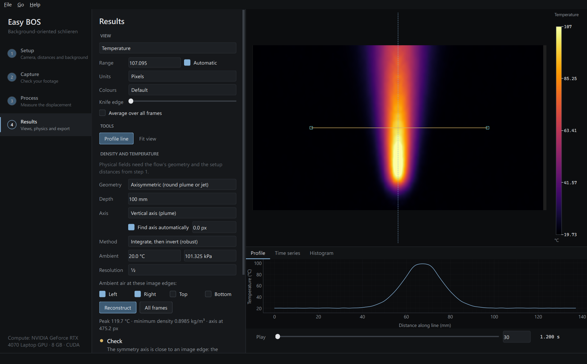
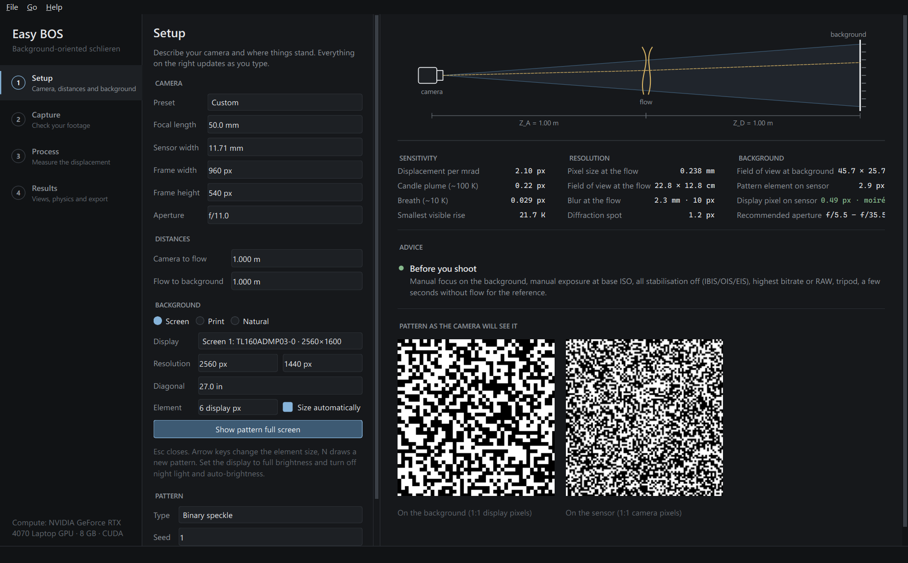
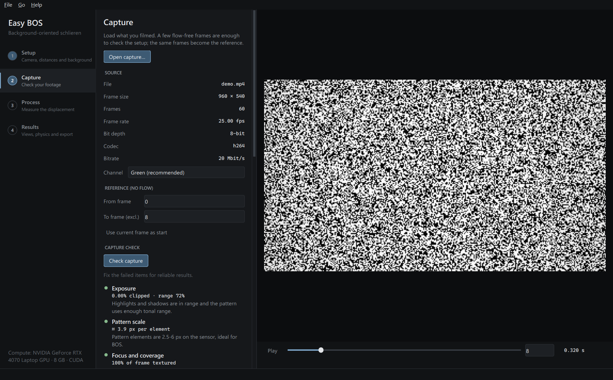
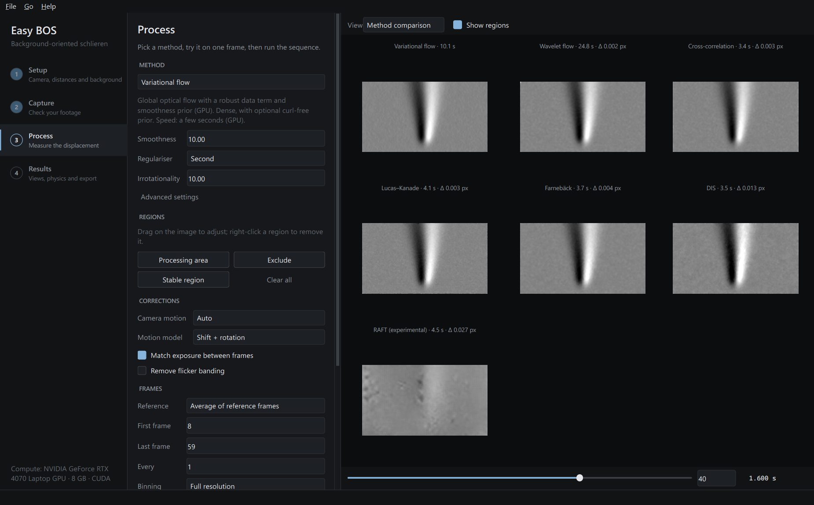

# Easy BOS

**See heat, gas and air flow with an ordinary camera.** Easy BOS is a Windows desktop application
for background-oriented schlieren (BOS): film a patterned background through the flow, and it
measures how the air bends light, frame by frame. It shows the flow as classic schlieren
images and, where the geometry allows, as density and temperature fields.



It covers the whole workflow:

1. **Setup.** Enter your camera and distances. Easy BOS predicts sensitivity, resolution and
   blur, sizes the background pattern, warns about moiré, and shows the pattern full screen on
   any monitor or TV, pixel-exact. It can also export it for printing.
2. **Capture.** Load video (including 10-bit HEVC), photos or RAW files. The capture check
   measures what matters for BOS: exposure, pattern sampling, focus, noise floor, camera
   stability, flicker banding, moiré and compression. Each item comes with a plain-language fix.
3. **Process.** Choose from seven displacement estimators, from instant DIS to wavelet optical
   flow, and run them on the GPU. You can compare them side by side on any frame. Camera shake,
   exposure drift and display flicker are corrected automatically.
4. **Results.** Views include knife-edge, magnitude, direction and colour schlieren, plus
   shadowgraph-like divergence. Density and temperature come from Abel inversion (round plumes
   and jets) or from planar integration. The page also has profiles, time series and
   histograms. You can export images, videos (H.264, ProRes, FFV1), HDF5 data, CSV profiles and
   publication figures with scale bars.

| Setup | Capture check | Method comparison |
|---|---|---|
|  |  |  |

## Install

**Windows, no programming needed.** Download the release package, unzip it and double-click
`Install Easy BOS.cmd`. It installs for the current user only, with no administrator rights.
It sets up a private Python environment with GPU-accelerated PyTorch (about 3 GB on first
install) and adds Start-menu and desktop shortcuts. Run it again to update.

Easy BOS uses an NVIDIA GPU (CUDA) when one is available and falls back to the CPU otherwise.
Everything works on the CPU, just more slowly.

**From source** (needs [uv](https://docs.astral.sh/uv/)):

```bash
uv sync
```

```bash
uv run easy-bos
```

New here? Use **Help → Open demo project**. It loads a synthetic hot plume with a matching
setup, so every step works without a camera.

## Getting good results

- **Turn off all stabilisation:** IBIS, OIS and electronic stabilisation. It warps frames far more
  than the effect you are measuring.
- **Lock focus and exposure.** Focus manually on the background; use manual exposure at base ISO.
- **Record flow-free frames first.** A few seconds without the flow at the start of each clip
  gives the reference.
- **Use the best quality your camera offers:** RAW stills, or video at the highest bitrate and
  bit depth. The benchmark below shows how much consumer H.264 costs on weak flows.
- **Choose distances with the Setup page.** Sensitivity grows with the flow-to-background
  distance, and so does blur of the flow. The page shows the trade-off for your lens.

## How it works

Air with a different temperature or composition has a slightly different refractive index, so
light rays bend as they pass through it. Seen through the flow, the background appears shifted
by a fraction of a pixel. Easy BOS measures that shift `D` between a flow-free reference and
each frame (`cur(x) = ref(x + D(x))`), and converts it to the deflection angle using the setup
geometry (Raffel 2015):

    D = f·Z_D / ((Z_A + Z_D − f)·p) · ε,     ε = (1/n₀) ∫ ∇n dz

- **Displacement estimators** (`src/easy_bos/core/flow`):
  - variational optical flow, with a Charbonnier data term and first- or second-order
    regularisation plus an optional curl penalty; this is the default;
  - wavelet optical flow (wOFV/wOFA);
  - multi-pass window-deformation cross-correlation;
  - dense Lucas–Kanade with a gain/offset model;
  - OpenCV Farnebäck and DIS;
  - RAFT, for comparison.

  All warping uses prefiltered B-splines, because cubic convolution biases sub-pixel estimates
  by ~10 %.
- **Physics** (`src/easy_bos/core/reconstruct`). Uncertainty-weighted least-squares
  integration (Rajendran et al. 2020) feeds the three-point Abel inversion (Dasch 1992) for
  axisymmetric flows, or a known-depth planar model. Density comes from the Gladstone–Dale
  relation (K = 2.26·10⁻⁴ m³/kg). Temperature comes from the ideal gas at constant pressure.
- **Validation.** A synthetic benchmark (`src/easy_bos/bench`) renders physically based
  captures through analytic refractive-index fields with exact ground truth. The fields are
  plumes, jets, a heated plate, a lens and turbulence. The renderer models the camera effects:
  depth-of-field blur, noise, PRNU, vignetting, real H.264/HEVC encoding, shake, rolling shutter,
  flicker banding and display moiré. Every method and every output is scored against the truth.

Research notes with sources for every design decision are in [`docs/research`](docs/research).
Full benchmark results are in [`docs/benchmark.md`](docs/benchmark.md).

## Accuracy

<!-- ACCURACY-TABLE -->
Default method (Variational flow) against the best method per scenario on the synthetic benchmark. EPE is the mean endpoint error in pixels; *rel* is EPE relative to the mean true displacement; temperature is the RMS error in the heated region, next to the optics-limited floor (*oracle*: reconstruction from the true displacement).

| Scenario | Default EPE (rel) | Best method | Best EPE | T error | T floor |
|---|---:|---|---:|---:|---:|
| Plume, ideal camera | 0.0002 (0.00) | Variational flow | 0.0002 | 1.0 K | 0.9 K |
| Plume, RAW stills | 0.0031 (0.02) | Variational flow | 0.0031 | 0.8 K | 0.9 K |
| Plume, phone H.264 | 0.0444 (0.34) | DIS | 0.0397 | 11.6 K | 0.9 K |
| Plume, 10-bit HEVC | 0.0408 (0.32) | DIS | 0.0360 | 8.9 K | 0.9 K |
| Weak disturbance (breath), RAW | 0.0028 (0.22) | Cross-correlation | 0.0027 | — | — |
| Weak disturbance (breath), H.264 | 0.0129 (1.00) | Cross-correlation | 0.0129 | — | — |
| Turbulent multi-scale field | 0.0032 (0.02) | Variational flow | 0.0032 | — | — |
| Weak lens (calibration object) | 0.0178 (0.05) | Variational flow | 0.0178 | — | — |
| Heated vertical plate (planar) | 0.0080 (0.02) | Variational flow | 0.0080 | 0.7 K | 0.1 K |
| Camera shake | 0.0036 (0.03) | Variational flow | 0.0036 | 0.7 K | 0.9 K |
| Rolling shutter, unsteady plume | 0.0034 (0.03) | Variational flow | 0.0034 | — | — |
| Display flicker banding | 0.0032 (0.03) | Wavelet flow | 0.0032 | — | — |
| Display moiré | 0.0039 (0.03) | Cross-correlation | 0.0038 | — | — |
| Random-dot background | 0.0036 (0.03) | Variational flow | 0.0036 | — | — |
| Multi-scale noise background | 0.0054 (0.04) | Cross-correlation | 0.0053 | — | — |
<!-- /ACCURACY-TABLE -->

## Development

```bash
uv run pytest
```

```bash
uv run pytest -m slow
```

```bash
uv run easy-bos-bench
```

```bash
uv run python -m easy_bos.bench.tune
```

- `uv run pytest` runs the fast unit tests: processing math, estimators against synthetic truth,
  reconstruction and the pipeline.
- `uv run pytest -m slow` runs the end-to-end UI test, offscreen.
- `uv run easy-bos-bench` runs the full synthetic benchmark and writes `docs/benchmark.md`.
- `uv run python -m easy_bos.bench.tune` runs the parameter sweeps behind the defaults and
  writes `docs/tuning.md`.

To build the installer package, run `installer/build.ps1`. It produces `dist/EasyBOS-<version>.zip`,
plus an `.exe` if Inno Setup 6 is installed.

Architecture, decisions and status for contributors are in [`AGENTS.md`](AGENTS.md).

## Licence

MIT. RAFT weights (optional, downloaded on first use) come from torchvision. They were trained
on research datasets whose terms may restrict commercial use.
