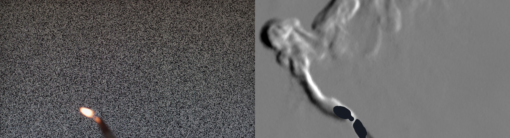
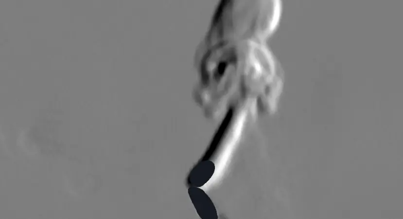
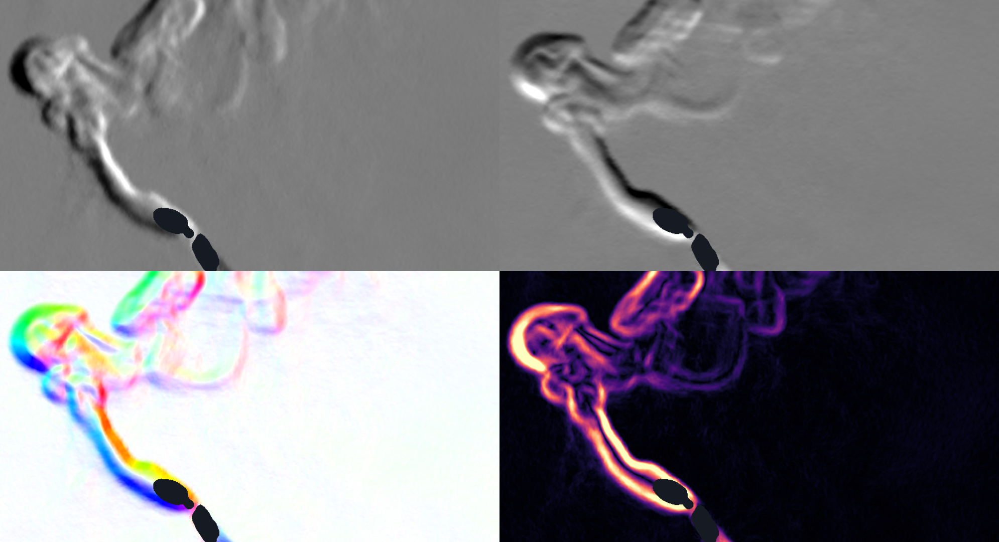
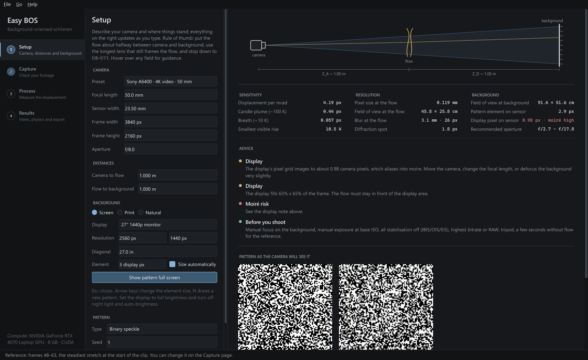
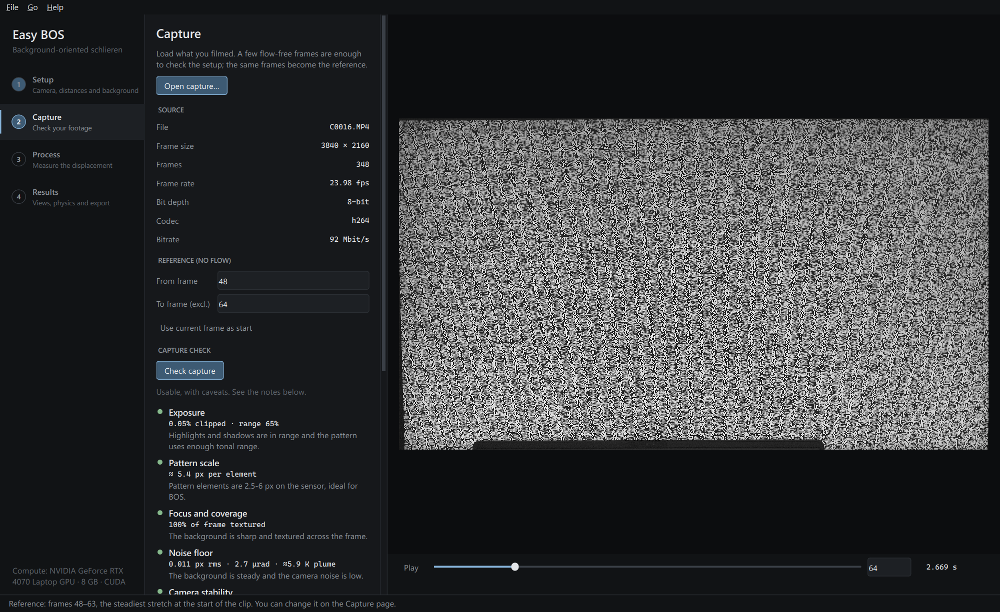
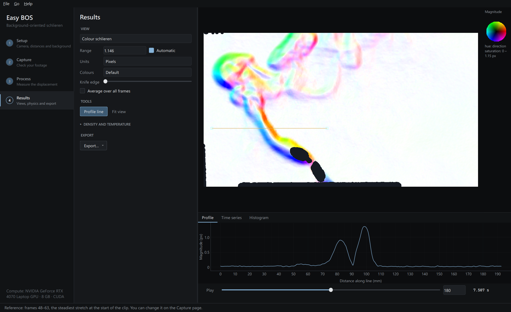
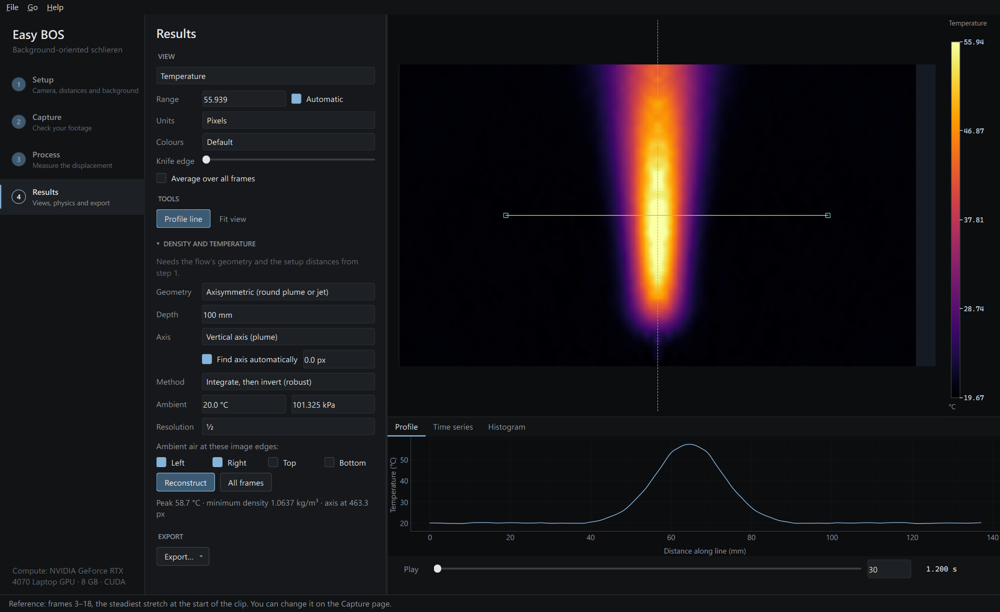
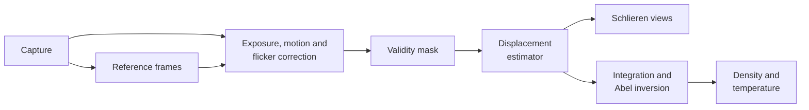

# Easy BOS

[](https://github.com/Sam-de-Ham/easy-bos/actions/workflows/ci.yml)
[](https://github.com/Sam-de-Ham/easy-bos/releases/latest)

[](https://docs.astral.sh/ruff/)
[](LICENSE)

See heat and air flow with an ordinary camera and a patterned background.

Easy BOS is a Windows desktop app for background-oriented schlieren (BOS). Film a random
pattern through the flow, on a monitor or printed, and it measures how far the pattern
appears to move in every frame. That shift, a small fraction of a pixel, is the bending of
light by warmer or lighter air. Easy BOS turns it into schlieren images and, for round plumes,
jets and planar flows, into density and temperature.



*Left: one frame from a Sony A6400 (4K H.264), a lighter in front of a 27" monitor showing a
speckle pattern. Right: the same frame in Easy BOS. The flame and the lighter block the
background, so they are masked out.*

- [What it does](#what-it-does)
- [Gallery](#gallery)
- [Install](#install)
- [Getting good results](#getting-good-results)
- [How it works](#how-it-works)
- [Accuracy](#accuracy)
- [Performance](#performance)
- [Development](#development)

## What it does

The app follows the four steps of an experiment.

1. **Setup.** Enter the camera, lens and distances. Easy BOS predicts the sensitivity,
   resolution and blur, sizes the background pattern for your sensor and warns about moiré.
   It shows the pattern full screen on any monitor or TV, pixel-exact, or exports it as a PDF
   for printing.
2. **Capture.** Open a video (including 10-bit HEVC), a folder of photos or RAW files. Easy
   BOS picks the steadiest flow-free frames at the start of the clip as the reference. The
   capture check measures what matters for BOS: exposure, pattern sampling, focus, noise
   floor, camera stability, flicker banding, moiré and compression, each with a plain fix.
3. **Process.** Choose Fast, Balanced or Best, or pick a method and its parameters yourself,
   and compare all methods on one frame side by side. Processing runs on the GPU. Camera
   shake, exposure drift and display flicker are corrected, and areas without background
   texture or behind an object are excluded automatically.
4. **Results.** Knife-edge and colour schlieren, deflection magnitude and direction,
   components and a shadowgraph-like divergence. Density and temperature from Abel inversion
   or a planar model. Profiles along a line, time series and histograms. Export images,
   video (H.264, ProRes, FFV1), HDF5, CSV and figures with scale bars.

## Gallery

The same clip over four seconds, processed with the default settings:



Four views of one frame: knife edge vertical and horizontal, colour schlieren (hue is the
direction of deflection) and deflection magnitude.



And the app itself:

| | |
|---|---|
| <br>**Setup** — sensitivity, blur and pattern size for a camera and distances | <br>**Capture check** — what will limit the measurement, before processing |
| <br>**Method comparison** — every method on the same frame | <br>**Results** — colour schlieren with a profile across the plume |
| <br>**Temperature** — Abel reconstruction of the synthetic demo plume | |

## Install

**Windows, no programming needed.** Download `EasyBOS-<version>.zip` from the
[latest release](https://github.com/Sam-de-Ham/easy-bos/releases/latest), unzip it and
double-click `Install Easy BOS.cmd`. It installs for the current user without administrator
rights, sets up a private Python environment with GPU-enabled PyTorch (about 3 GB the first
time) and adds Start-menu and desktop shortcuts. Run it again to update.

**From source**, with [uv](https://docs.astral.sh/uv/):

```bash
git clone https://github.com/Sam-de-Ham/easy-bos
cd easy-bos
uv run easy-bos
```

Easy BOS uses an NVIDIA GPU through CUDA when there is one and the CPU otherwise; everything
works on the CPU, more slowly. The tests also run on Linux; the app itself is only used on
Windows.

To try it without a camera, use **Help → Open demo project**: a synthetic hot plume with a
matching setup.

## Getting good results

- **Turn off stabilisation,** in the body and the lens. It warps the frame far more than the
  effect you are measuring.
- **Lock focus and exposure.** Focus manually on the background; use manual exposure at base
  ISO.
- **Start with a few seconds of still air.** Start recording, wait 2–3 s for the tripod to
  settle, then start the flow. Easy BOS finds the steady stretch itself.
- **Use the best recording your camera offers:** RAW stills, or video at the highest bitrate
  and bit depth. The accuracy table below shows what consumer H.264 costs on weak flows.
- **Choose the distances on the Setup page.** Sensitivity grows with the distance between the
  flow and the background, and so does the blur of the flow. The page shows the trade-off for
  your lens.

## How it works

Air at a different temperature or composition has a slightly different refractive index, so
light passing through it bends. Seen through the flow, the background appears shifted by a
fraction of a pixel. Easy BOS measures that shift `D` between a flow-free reference and each
frame, and converts it to the deflection angle `ε` from the setup geometry:

```
D = f · Z_D / ((Z_A + Z_D − f) · p) · ε,      ε = (1/n₀) ∫ ∇n dz
```

with `f` the focal length, `Z_A` the camera-to-flow distance, `Z_D` the flow-to-background
distance and `p` the pixel pitch.



- **Displacement.** Variational optical flow ("Best": Charbonnier data term, second-order
  regularisation and a curl penalty, solved by DCT-preconditioned conjugate gradients),
  multi-pass window-deformation cross-correlation ("Balanced", and a coarser setting for
  "Fast"), dense Lucas–Kanade with a gain and offset model, and OpenCV's Farnebäck and DIS.
  Wavelet optical flow and RAFT are in the library and the benchmark for comparison. All
  warping uses prefiltered cubic B-splines: cubic convolution biases sub-pixel shifts by
  about 10 %.
- **Corrections.** BOS fields are curl-free, so camera rotation shows up as curl and is
  separated from the flow; translation is the dominant mode of the displacement. Exposure is
  matched by the mean intensity ratio, and display flicker by row gains.
- **Physics.** Weighted least-squares integration (Rajendran et al. 2020) followed by
  three-point Abel inversion (Dasch 1992) for axisymmetric flows, or a known depth for planar
  ones. Density from the Gladstone–Dale relation, temperature from the ideal gas law at
  constant pressure.

The reasoning behind each choice is in [docs/architecture.md](docs/architecture.md), and the
literature in [docs/research](docs/research).

## Accuracy

A synthetic benchmark renders captures through analytic refractive-index fields with exact
ground truth: plumes, a heated plate, a weak lens, a faint breath-like disturbance and
turbulence. The camera model includes depth-of-field blur, noise, PRNU, vignetting, real
H.264 and HEVC encoding, shake, rolling shutter, display flicker and moiré. Full results are
in [docs/benchmark.md](docs/benchmark.md).

<!-- ACCURACY-TABLE -->
Default method (Variational flow) against the best method per scenario on the synthetic benchmark. EPE is the mean endpoint error in pixels; *rel* is EPE relative to the mean true displacement; temperature is the RMS error in the heated region, next to the optics-limited floor (*oracle*: reconstruction from the true displacement).

| Scenario | Default EPE (rel) | Best method | Best EPE | T error | T floor |
|---|---:|---|---:|---:|---:|
| Plume, ideal camera | 0.0002 (0.00) | Variational flow | 0.0002 | 1.0 K | 0.9 K |
| Plume, RAW stills | 0.0030 (0.02) | Wavelet flow | 0.0030 | 0.7 K | 0.9 K |
| Plume, phone H.264 | 0.0443 (0.34) | DIS | 0.0393 | 12.1 K | 0.9 K |
| Plume, 10-bit HEVC | 0.0407 (0.32) | DIS | 0.0357 | 9.5 K | 0.9 K |
| Weak disturbance (breath), RAW | 0.0028 (0.22) | Cross-correlation | 0.0028 | — | — |
| Weak disturbance (breath), H.264 | 0.0130 (1.01) | Cross-correlation | 0.0130 | — | — |
| Turbulent multi-scale field | 0.0031 (0.02) | Variational flow | 0.0031 | — | — |
| Weak lens (calibration object) | 0.0182 (0.05) | Variational flow | 0.0182 | — | — |
| Heated vertical plate (planar) | 0.0075 (0.02) | Variational flow | 0.0075 | 0.5 K | 0.1 K |
| Camera shake | 0.0036 (0.03) | Variational flow | 0.0036 | 0.7 K | 0.9 K |
| Rolling shutter, unsteady plume | 0.0034 (0.03) | Wavelet flow | 0.0034 | — | — |
| Display flicker banding | 0.0032 (0.02) | Wavelet flow | 0.0031 | — | — |
| Display moiré | 0.0038 (0.03) | Cross-correlation | 0.0037 | — | — |
| Random-dot background | 0.0036 (0.03) | Variational flow | 0.0036 | — | — |
| Multi-scale noise background | 0.0055 (0.04) | Cross-correlation | 0.0053 | — | — |
<!-- /ACCURACY-TABLE -->

Lossy video is the main limit: with consumer H.264 every method lands near 0.04 px, more than
ten times the error from RAW stills. On the real 4K clips above, the noise floor with the
automatic reference is 0.011–0.020 px, enough to see a plume about 6–10 K above ambient at
that geometry.

## Performance

Real footage: Sony A6400, 4K H.264 at 92 Mbit/s, processed at 1080p (automatic) on an
RTX 4070 Laptop GPU.

| Step | Time |
|---|---|
| Open a clip and choose the reference frames | ~1 s, plus ~6 s in the background |
| Capture check | ~6 s |
| Process, Fast | 0.17 s per frame (about 50 s for a 300-frame clip) |
| Process, Balanced | 0.30 s per frame |
| Process, Best | 1.3 s per frame |

## Development

```bash
uv sync
uv run pytest                  # fast tests
uv run pytest -m slow          # end-to-end UI test, offscreen
uv run easy-bos-bench          # synthetic benchmark → docs/benchmark.md
uv run ruff check . && uv run ruff format --check .
```

`installer/build.ps1` builds the release package. See [CONTRIBUTING.md](CONTRIBUTING.md).

## License

[MIT](LICENSE). The optional RAFT weights, downloaded on first use, come from torchvision and
were trained on research datasets whose terms may restrict commercial use.
